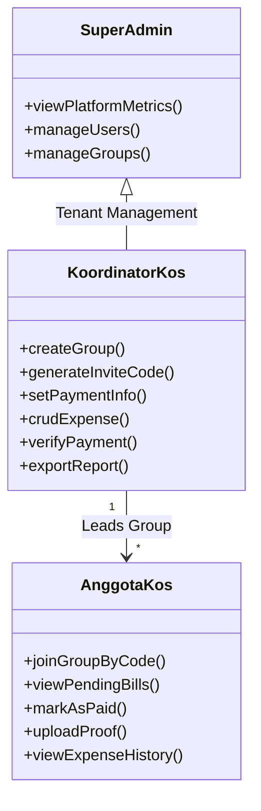
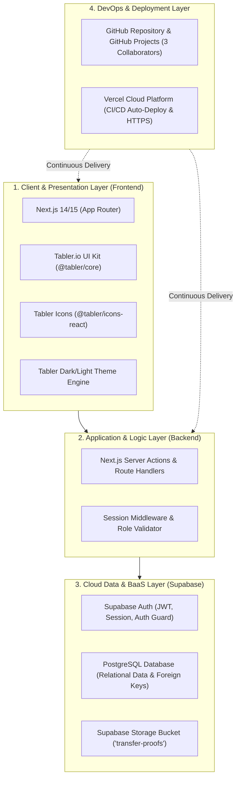
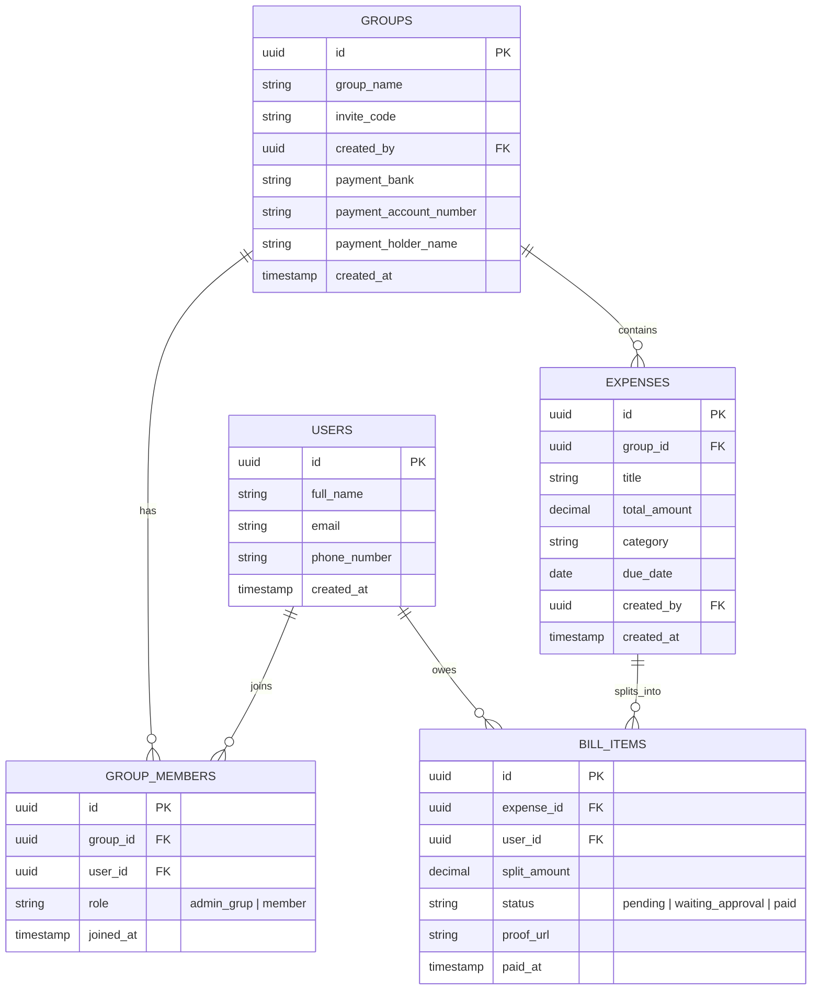

# PRODUCT REQUIREMENT DOCUMENT (PRD)
## Produk SaaS: **KasKos** (Kelola Kas & Tagihan Patungan Anak Kos)

> **Motto Produk:** *"Urusan Kas Beres, Hubungan Roommate Tetap Adem."*  
> **Target Kelompok:** 3 Mahasiswa  
> **Siklus Produk:** Build → Manage → Market → Test → Improve  

---

## 1. Executive Summary & Problem Framing

### 1.1 Latar Belakang Masalah (The Real Problem)
Tinggal bersama dalam satu kamar kos atau rumah kontrakan menuntut adanya pengeluaran bersama (shared expenses) seperti:
* Iuran listrik / token PLN bulanan.
* Tagihan internet / WiFi indihome/biznet.
* Kebutuhan pokok bersama (galon air minum, beras, gas LPG, iuran kebersihan/sampah).

**Titik Temu Masalah (Pain Points):**
1. **Sering Lupa & Tidak Transparan:** Pencatatan di kertas atau whiteboard sering hilang, sedangkan pencatatan via grup WhatsApp cepat tenggelam oleh obrolan harian.
2. **Drama Penagihan:** Penanggung jawab / bendahara kos sering merasa tidak enak atau canggung (*sungkan*) saat harus berulang kali menagih teman sendiri.
3. **Ketidaksesuaian Nominal:** Perhitungan manual rawan keliru, terutama ketika ada anggota yang sudah membayar sebagian atau menalangi pengeluaran terlebih dahulu.

### 1.2 Solusi Produk (The Solution)
**KasKos** adalah aplikasi web micro-SaaS berbasis langganan kelompok yang memfasilitasi anak kos untuk membuat grup kamar/kontrakan, membagi tagihan secara otomatis, memantau status pembayaran per anggota, serta menyimpan riwayat pengeluaran yang transparan.

### 1.3 Target Pengguna
* **Primer:** Mahasiswa atau pekerja muda yang tinggal di kontrakan / kos bersama (2–8 orang per unit).
* **Sekunder:** Pengurus paguyuban kamar kos / asrama mahasiswa.

---

## 2. Arsitektur Peran Pengguna (User Roles & Permissions)

Sistem mengadopsi konsep multi-tenant grup berbasis kode undangan:

| Fitur / Hak Akses | Anggota Kos (Member) | Koordinator Kos (Admin Grup) | Super Admin (Tim Anda) |
| :--- | :---: | :---: | :---: |
| Register, Login, Ubah Profil | ✅ | ✅ | ✅ |
| Buat Grup Kos Baru | ❌ | ✅ | ✅ |
| Bergabung via Kode Undangan | ✅ | ❌ (Otomatis pemilik) | ❌ |
| Tambah / Edit / Hapus Tagihan (CRUD) | ❌ | ✅ | ✅ |
| Melihat Dashboard & Total Tunggakan | ✅ (Milik Pribadi) | ✅ (Semua Anggota) | ✅ (Global) |
| Konfirmasi *"Sudah Bayar"* & Upload Bukti | ✅ | ✅ | ❌ |
| Verifikasi Pelunasan (Ubah ke *Lunas*) | ❌ | ✅ | ✅ |
| Mengatur Nomor Rekening / E-Wallet Kos | ❌ | ✅ | ❌ |
| Monitoring Seluruh Data Platform | ❌ | ❌ | ✅ |

---

## 3. Spesifikasi Fitur Produk (Website SaaS — Bobot 30%)

### 3.1 Modul Fungsional Utama
1. **Landing Page (Publik):**
   * Value Proposition & Hero Section.
   * Ilustrasi masalah vs solusi KasKos.
   * Fitur unggulan (Split otomatis, transparansi kas, bukti bayar).
   * Call-to-Action (CTA): *"Mulai Gratis Sekarang"*.
2. **Autentikasi & Akun:**
   * Registrasi (Nama, Email, Password, No WhatsApp).
   * Login & Logout dengan validasi sesi token/cookie.
   * Reset/Ubah Password sederhana.
3. **Manajemen Grup Kos (Workspace):**
   * Pembuatan grup dengan nama unik (contoh: *"Kontrakan Mawar No. 4"*).
   * Auto-generate **6-digit Invite Code** untuk dibagikan ke teman.
   * Form pengaturan rekening transfer (Bank BCA/BRI/Mandiri & Dana/GoPay/ShopeePay).
4. **CRUD Tagihan & Pengeluaran (Core Feature):**
   * **Create:** Input judul pengeluaran, nominal total, kategori (Listrik/Air/WiFi/Kebutuhan Lain), tanggal jatuh tempo, dan opsi bagi rata ke semua anggota aktif.
   * **Read:** Tabel daftar tagihan aktif, filter berdasarkan status (Belum Lunas / Lunas / Menunggu Verifikasi).
   * **Update:** Edit nominal/keterangan jika terjadi perubahan harga.
   * **Delete:** Hapus tagihan (soft delete / hard delete dengan konfirmasi).
5. **Dashboard Interaktif:**
   * **Sisi Koordinator:** Total kas terkumpul, sisa tagihan belum lunas, persentase pembayaran bulan berjalan.
   * **Sisi Anggota:** Kotak peringatan tagihan pribadi (*"Kamu memiliki tagihan sebesar Rp 35.000 untuk Token Listrik"*).
6. **Mobile-Responsive UI:**
   * Desain responsif mobile-first menggunakan sistem layout & grid bawaan Tabler.io agar nyaman diakses langsung dari smartphone oleh anak kos.

### 3.2 Pondasi Teknologi & Arsitektur Sistem (Technology Foundations)

Sistem KasKos dibangun menggunakan tumpukan teknologi modern (*Modern Cloud Jamstack*) yang efisien, handal, berbiaya Rp 0 (Free-Tier), dan siap produksi:

#### Rincian Komponen Pondasi Teknologi:

| Lapisan (Layer) | Teknologi Terpilih | Peran & Spesifikasi dalam Sistem KasKos |
| :--- | :--- | :--- |
| **Frontend Framework** | **Next.js 14/15 (App Router)** | • Framework Fullstack modern berbasis React. • Server-Side Rendering (SSR) untuk kecepatan loading landing page & Client Components untuk interaktivitas dashboard. |
| **UI Kit & Template** | **Tabler.io (`@tabler/core`)** | • Framework UI dashboard open-source berbasis CSS modern. • **Stat Cards:** Menampilkan total kas terkumpul, sisa tunggakan, dan jumlah anggota kamar secara visual. • **Data Tables:** Tabel tagihan kas dengan fitur sorting, filtering status, dan pagination. • **Badges:** Penanda status berwarna (`bg-green-lt` untuk Lunas, `bg-yellow-lt` untuk Menunggu Verifikasi, `bg-red-lt` untuk Belum Bayar). • **Modals & Dialogs:** Pop-up interaktif untuk form tambah tagihan baru dan pratinjau bukti transfer. • **Mobile Responsive & Dark Mode:** Otomatis menyesuaikan layar smartphone dan desktop. |
| **Icon Library** | **Tabler Icons (`@tabler/icons-react`)** | • Koleksi lebih dari 4.000+ ikon SVG modern. • Ikon kategori pengeluaran: `IconBolt` (listrik), `IconWifi` (internet), `IconDroplet` (air galon), `IconFlame` (gas LPG), `IconTrash` (kebersihan), `IconReceipt` (tagihan). |
| **Backend & Logic** | **Next.js Server Actions & Middleware** | • Menjalankan fungsi create, update, delete (CRUD) langsung di sisi server secara aman tanpa mengekspos kredensial database ke browser. • Middleware untuk memvalidasi hak akses (Role Guard: Koordinator vs Member). |
| **Autentikasi Pengguna** | **Supabase Auth** | • Manajemen akun terintegrasi: registrasi, login, logout, sesi JWT aman, dan verifikasi email/kata sandi tanpa perlu membangun sistem hash manual. |
| **Database Relasional** | **PostgreSQL (via Supabase)** | • Database relasional standar industri untuk menyimpan tabel pengguna, grup kamar kos, tagihan, dan pembagian iuran secara konsisten (ACID compliant). • Dilengkapi panel visual Table Editor di dashboard Supabase untuk memudahkan pemantauan data uji. |
| **Penyimpanan Berkas** | **Supabase Storage** | • Bucket cloud penyimpanan berkas publik/privat (`transfer-proofs`) untuk menyimpan screenshot bukti transfer saat anggota mengonfirmasi pembayaran. |
| **Version Control & PM** | **GitHub + GitHub Projects** | • Repositori bersama dengan 3 mahasiswa sebagai collaborator. • Pelacakan tugas dengan papan Kanban (Backlog → Todo → In Progress → Review → Done) dan GitHub Issues. • Standar commit message konvensional (`feat:`, `fix:`, `docs:`). |
| **Hosting & CI/CD** | **Vercel** | • Terhubung langsung dengan branch `main` GitHub. • Setiap ada perubahan kode (Git Push), Vercel otomatis melakukan *build*, testing, dan *live deployment* ke URL online publik gratis dengan sertifikat SSL (HTTPS). |

### 3.3 Skema Database Relasional (Database Schema)

---

## 4. Manajemen Proyek & Kolaborasi GitHub (Bobot 20%)

### 4.1 Pembagian Peran Tim & Kontribusi GitHub (Kelompok 3 Mahasiswa)

Untuk memastikan penilaian GitHub (20%) optimal, setiap anggota memiliki fokus kontribusi kode di repositori (5 task teknis per orang), sedangkan tugas non-teknis (branding, konten media sosial, tester kuesioner, dan laporan akhir) dikerjakan bersama secara kolaboratif:

| Anggota Tim | Domain Teknis di GitHub | Tanggung Jawab Kode / Fitur Spesifik |
| :--- | :--- | :--- |
| **Mahasiswa 1 (Lead)** | **Backend Core, Database & Auth** | Setup repositori, Database schema PostgreSQL & RLS Supabase, Auth logic & Middleware guard, serta Server Actions manajemen grup kos. |
| **Mahasiswa 2** | **Coordinator Dashboard & Expense Split** | Setup Next.js + Tabler.io UI foundation, tampilan Dashboard Koordinator, Server Actions CRUD pengeluaran + auto-split, dan approval pembayaran. |
| **Mahasiswa 3** | **Member Experience, Payment Flow & DevOps** | Halaman Landing Page publik, Auth Pages UI, tampilan Dashboard Anggota Kos (alert tagihan & copy rekening), upload bukti transfer ke Storage, serta GitHub Actions CI & seed data. |

> *Catatan: Aktivitas non-GitHub seperti Branding (Logo/Palet), Produksi 10 Konten Medsos, Pengujian 10 Tester, dan Penyusunan Dokumen Laporan Akhir dikerjakan secara gotong royong oleh seluruh anggota.*

### 4.2 Standar Repositori & Workflow Git
* **Branching Strategy:**
  * `main` : Source code siap deploy (Production).
  * `development` : Integrasi fitur sebelum rilis.
  * `feat/<nama-fitur>` atau `fix/<nama-bug>` : Pengerjaan task individual per anggota.
* **Konvensi Commit Messages:**
  * `feat: add split expense algorithm`
  * `fix: correct status badge on mobile view`
  * `docs: update setup instructions in README.md`
  * `style: improve dashboard padding on mobile`
* **GitHub Projects Setup:**
  * Kolom: **Backlog** → **Todo** → **In Progress** → **In Review (PR)** → **Done**.
  * Setiap task dipecah menjadi GitHub Issues dengan estimasi dan penugasan (Assignee) yang jelas untuk ketiga anggota.

---

## 5. Strategi Media Sosial & Content Marketing (Bobot 20%)

### 5.1 Profil Identitas Brand
* **Nama Akun:** `@kaskos.id` / `@kaskos_app` (Instagram & TikTok).
* **Bio Instagram:**
  > *"Solusi tagihan patungan kos tanpa drama. Catat token, wifi, & galon otomatis! 👇 Coba versi web gratis:"*  
  > *Link bio: https://kaskos.vercel.app*
* **Aset Visual:** Logo minimalis bertema dompet/rumah dengan nuansa warna segar (Emerald Green & Charcoal Slate).

### 5.2 Rencana 10 Konten Pemasaran Organik (Educate → Engage → Promote)

| No | Tipe Pilar | Format Konten | Judul / Hook Konten | Inti Pesan & Call To Action (CTA) |
| :-: | :--- | :--- | :--- | :--- |
| **1** | **Introduce** | Carousel IG | *"Kenalin KasKos: Selamat Tinggal Drama Uang Kas Kos!"* | Pengenalan produk, masalah umum anak kos, dan solusi yang ditawarkan. |
| **2** | **Problem** | Video Reels/TikTok | *"POV: Kamu bendahara kos yang nagih uang wifi di grup tapi di-read doang."* | Menyorot frustrasi nyata bendahara kos secara humoris dan relate. |
| **3** | **Educate** | Carousel IG | *"5 Tagihan Rutin Anak Kos yang Sering Bikin Rusuh Kalau Gak Dicatat."* | Edukasi pentingnya transparansi pengeluaran bersama (listrik, wifi, galon, beras, gas). |
| **4** | **Feature** | Video Singkat | *"Gak Perlu Kalkulator! Fitur Split Tagihan Otomatis di KasKos."* | Menunjukkan cara kerja pembagian tagihan rata per anak kos dalam hitungan detik. |
| **5** | **Tutorial** | Carousel Panduan | *"Tutorial Bikin Grup Kontrakan di KasKos dalam 1 Menit."* | Step-by-step: Register → Buat Grup → Share Kode Invite ke teman. |
| **6** | **Demo** | Video Screen Record | *"Live Demo: Cara Anggota Bayar & Upload Bukti Transfer."* | Memperlihatkan alur anggota konfirmasi pembayaran hingga terverifikasi lunas. |
| **7** | **Tips/Insight** | Infografis | *"Tips Mengelola Keuangan Kontrakan Bareng Roommate Biar Gak Boncos."* | Edukasi budgeting anak kos untuk meningkatkan engagement & shareable content. |
| **8** | **Advantage** | Grafis Komparasi | *"Catat di Buku vs Catat di KasKos: Mana yang Lebih Anti Ribet?"* | Tabel perbandingan langsung: risiko buku basah/hilang vs cloud database online. |
| **9** | **Social Proof** | Carousel Testimoni | *"Apa Kata 10 Anak Kos yang Udah Nyobain KasKos?"* | Mengutip cuplikan ulasan asli dari tester awal mengenai kemudahan aplikasi. |
| **10**| **Promote/CTA** | Banner Promo | *"Kontrakanmu Masih Catat Manual? Cobain KasKos Sekarang, 100% Gratis!"* | CTA kuat untuk mengajak follower mengklik link bio dan mencoba website. |

---

## 6. Rencana Pengujian Pengguna Awal (Early Tester — Bobot 20%)

### 6.1 Skenario Pengujian (10 Tester Nyata)
Pengujian dilakukan terhadap minimal 10 mahasiswa/anak kos dengan pembagian:
* **2 Orang Penguji:** Berperan sebagai **Koordinator Kos** (membuat 2 grup kos berbeda).
* **8 Orang Penguji:** Berperan sebagai **Anggota Kos** (bergabung ke grup kos dan menguji alur tagihan).

### 6.2 Instrumen Evaluasi & Pertanyaan Kuesioner
Setiap tester diminta menjalankan task:
1. Registrasi & Login.
2. Join grup menggunakan kode invite.
3. Membuka dashboard dan mengecek tagihan yang diberikan.
4. Menekan tombol konfirmasi bayar dan upload dummy screenshot.

**Daftar Pertanyaan Feedback:**
1. Seberapa mudah proses pendaftaran dan bergabung ke grup kos? (Skala 1–5)
2. Apakah informasi nominal tagihan dan nomor rekening tujuan terlihat jelas?
3. Fitur apa yang menurut Anda paling membantu?
4. Bagian mana yang membingungkan atau mengalami kendala teknis (bug)?
5. Saran apa yang paling mendesak untuk ditambahkan/diperbaiki?
6. Apakah Anda bersedia merekomendasikan website ini ke teman kontrakan Anda? (Ya/Tidak)

### 6.3 Siklus Iterasi Feedback & Perbaikan (The Feedback Loop)
Untuk memenuhi poin penilaian 5% *Perbaikan Berdasarkan Feedback*, kelompok mendokumentasikan:
* **Temuan Masalah (Feedback Awal):** Contoh: *"Tester merasa kesulitan menyalin (copy) nomor rekening bendahara karena teksnya kecil."*
* **Analisis & Keputusan:** Menambahkan tombol satu-klik *"Salin No. Rekening"* di sebelah nominal tagihan.
* **Tindakan Perbaikan (Changelog):** Commit perubahan ke GitHub (`feat: add one-click copy account number button`) dan verifikasi ulang ke tester.

---

## 7. Rencana Presentasi & Live Demo (Bobot 10%)

### 7.1 Alur Waktu Presentasi (Total 15 Menit)

```mermaid
gantt
    title Alokasi Waktu Presentasi (Maks 15 Menit)
    dateFormat  m
    axisFormat %M m
    Pembukaan & Latar Belakang Masalah :done, 0, 2m
    Arsitektur Sistem & GitHub Workflow  :done, 2, 5m
    LIVE DEMO (Koordinator + Member Interaksi) :active, 5, 11m
    Laporan Marketing & Hasil 10 Tester : 11, 14m
    Kesimpulan & Penutup : 14, 15m
```

* **Menit 0–2 (Pengantar):** Presentasi masalah nyata anak kos dan visi KasKos.
* **Menit 2–5 (Teknologi & Manajemen Tim):** Tunjukkan repositori GitHub, commit history, dan GitHub Projects board.
* **Menit 5–11 (LIVE DEMO - Wajib & Interaktif):**
  * Presenter 1 (di laptop): Login sebagai Koordinator, buat tagihan *"Token Listrik Rp 100.000"*.
  * Presenter 2 (di smartphone): Buka web sebagai Anggota, tunjukkan notifikasi tagihan masuk Rp 25.000, lalu klik konfirmasi bayar.
  * Presenter 1: Refresh halaman, verifikasi pembayaran menjadi LUNAS.
* **Menit 11–14 (Hasil Market & Tester):** Tampilkan 10 konten medsos yang sudah dipublish dan tabel iterasi feedback tester.
* **Menit 14–15 (Q&A Ready):** Penutupan.

---

## 8. Checklist Kelengkapan Output Akhir

- [ ] Tautan Website SaaS yang aktif (Deployed di Vercel/Railway).
- [ ] Tautan Repositori GitHub publik/dosen diundang.
- [ ] Bukti 3 mahasiswa terdaftar sebagai Collaborator dengan commit aktif.
- [ ] Board GitHub Projects dengan kartu task selesai (Done).
- [ ] Tautan akun Instagram/TikTok dengan minimal 10 konten terpublikasi.
- [ ] Form kuesioner & spreadsheet data 10 pengguna awal (tester).
- [ ] Bukti log commit/screenshot perbaikan produk berdasarkan feedback tester.
- [ ] Slide presentasi (PDF/Canva) & dokumen laporan akhir.
